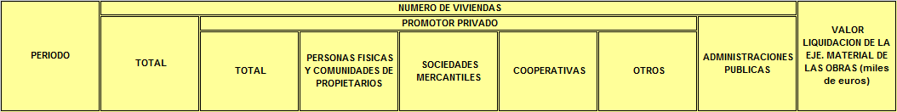

# MIVAU-BOL09-FINOBRA: certificados de fin de obra (viviendas terminadas, por promotor)

Tabla `mivau_certificados_fin_obra`. Serie mensual NACIONAL (el archivo no trae comunidades ni provincias).

## URL
https://apps.fomento.gob.es/BoletinOnline/sedal/09011600.XLS (columna `fuente` de `etl/catalogo/tablas.csv`). Ojo: es la ruta antigua `BoletinOnline`, no `BoletinOnline2` (que devuelve 404 para este archivo).

## Archivo y fecha de descarga
`etl/descargas/MIVAU-BOL09-FINOBRA_AAAAMMDD.xls` (no versionado). Descargado el 2026-10-29 (pie del archivo: "Fecha: 28/10/2026"). El test usa una copia completa en `tests/fixtures/09011600.xls` (1,1 MB, versionada; el tamaño se debe a un logotipo JPEG incrustado de 1 MB). Destino: `etl/salida/mivau_certificados_fin_obra.csv`.

## Estructura del original
Un libro .xls con una sola hoja, `APAREJA_15` (430 filas x 14 columnas). Título en B2: "15.- CERTIFICACIONES FIN DE OBRA"; B4: "N.º de viviendas según promotor. Valor de liquidación (uso residencial y no residencial)"; B6: "TOTAL NACIONAL" (único territorio).

- **No hay ninguna cabecera de columna en forma de texto**: las filas 1 a 7 de las columnas de valores están vacías. Los rótulos son una imagen PNG incrustada en el .xls (1054 x 132 px). Se extrajo del flujo del libro y se leyó: PERIODO | NUMERO DE VIVIENDAS: TOTAL | PROMOTOR PRIVADO: TOTAL, PERSONAS FISICAS Y COMUNIDADES DE PROPIETARIOS, SOCIEDADES MERCANTILES, COOPERATIVAS, OTROS | ADMINISTRACIONES PUBLICAS | VALOR LIQUIDACION DE LA EJE. MATERIAL DE LAS OBRAS (miles de euros).

Receta de extracción (reproducible): `python -m etl.herramientas.extraer_imagenes_xls tests/fixtures/09011600.xls <carpeta>` recorre el flujo Workbook del .xls, une los registros MsoDrawingGroup y guarda cada imagen (la de ~1 MB es el logotipo; la pequeña es la cabecera). Copia guardada en `docs/fuentes/img/MIVAU-BOL09-FINOBRA_cabecera.png`.

| Columna de la hoja | Texto de la imagen | Columna destino |
|---|---|---|
| E | NUMERO DE VIVIENDAS: TOTAL | `promotor = TOTAL`, `num_viviendas` |
| F | PROMOTOR PRIVADO: TOTAL | `PRIVADO_TOTAL` |
| G | PERSONAS FISICAS Y COMUNIDADES DE PROPIETARIOS | `PRIVADO_PERSONAS_FISICAS` |
| H | SOCIEDADES MERCANTILES | `PRIVADO_SOCIEDADES` |
| I | COOPERATIVAS | `PRIVADO_COOPERATIVAS` |
| J | OTROS | `PRIVADO_OTROS` |
| K, L | (vacías; celdas combinadas bajo ADMINISTRACIONES PUBLICAS) | no se carga |
| M | ADMINISTRACIONES PUBLICAS | `ADMINISTRACIONES_PUBLICAS` |
| N | VALOR LIQUIDACION DE LA EJE. MATERIAL DE LAS OBRAS (miles de euros) | `valor_liquidacion_miles_eur` (solo `TOTAL`) |

- Columna B: año; columna D: mes ("Ene" a "Dic"); valores en E a N.
- Filas 8 a 12: totales anuales 2025 a 2021 (año sin mes). Filas 14 a 429: bloques mensuales descendentes de 2026M06 (fila 14) a 1991M11 (fila 429); el año aparece solo en la primera fila de cada bloque. Fila 430: "Fuente: M. Transportes y Movilidad Sostenible / Fecha: 28/10/2026".
- Correspondencia columna -> significado (la imagen es la fuente; las sumas TOTAL = privado + administraciones y privado = cuatro tipos se cumplen en los 416 meses y comprueban solo que cada subtotal está en su sitio): E = total; F = privado total; G = personas físicas; H = sociedades; I = cooperativas; J = otros; K y L vacías (celdas combinadas bajo la cabecera de administraciones); M = administraciones públicas; N = valor de liquidación (miles de euros).

## Transformaciones
1. `mivau.leer_serie_vertical` (lector nuevo, `etl/lib/mivau.py`) pasa la hoja a formato largo: territorio, año, mes, índice de columna, texto de la celda. Ignora las filas anuales (son la suma de sus meses).
2. `fuente_comun.serie_vertical_a_tabla` aplica el mapa explícito columna -> (`promotor`, medida) del módulo `etl/fuentes/mivau_fin_obra.py`, y falla si hay datos en una columna no mapeada.
3. "TOTAL NACIONAL" se resuelve contra Maestro Territorios (`ES`). Periodo `AAAAMmm`, `frecuencia` M, `fecha` día 1.
4. `num_viviendas` entero (Int64); `valor_liquidacion_miles_eur` decimal con 1 decimal, solo en la fila `promotor = TOTAL`.
5. `provisional` = 0, `fecha_descarga` = día de ejecución. No hay uniprovinciales que expandir (no hay filas de comunidad).

Resultado: 2.912 filas = 7 promotores x 416 meses (1991M11 a 2026M06).

## Decisiones
- Una tabla con dimensión `promotor` (valores `TOTAL`, `PRIVADO_TOTAL`, `PRIVADO_PERSONAS_FISICAS`, `PRIVADO_SOCIEDADES`, `PRIVADO_COOPERATIVAS`, `PRIVADO_OTROS`, `ADMINISTRACIONES_PUBLICAS`), porque todas comparten el mismo recuento y las mismas unidades. `TOTAL` y `PRIVADO_TOTAL` se guardan como categorías (igual que en el original); quien sume `promotor` debe evitar el doble recuento.
- El valor de liquidación se guarda como segunda medida de la misma tabla, solo en `TOTAL` (la fuente no lo desglosa por promotor): NULL en las demás filas.
- Las filas anuales no se cargan: son la suma de los meses (comprobado 2021-2025) y mezclarían frecuencias en la tabla.
- Los rótulos de columna se tomaron de la imagen incrustada: no son texto del archivo. Pendiente de revisión por el usuario.
- El catálogo preveía el desglose territorial (CCAA): el archivo es solo nacional, así que el territorio es siempre `ES`.
- Ver `docs/decisiones.md` (2026-10-29).

## Limitaciones
- Solo nivel nacional. Sin marca de provisional (los últimos meses pueden revisarse en descargas posteriores; UPSERT).
- `num_viviendas` es de uso residencial según el título; el valor de liquidación cubre uso residencial y no residencial.
- Serie descendente que empieza en 1991M11 (no hay datos anteriores en el archivo).
- Dependencia del mapa de columnas por posición. Controles en cada ejecución: (a) una columna con datos fuera del mapa hace fallar el proceso; (b) las identidades TOTAL = PRIVADO_TOTAL + ADMINISTRACIONES_PUBLICAS y PRIVADO_TOTAL = suma de sus cuatro tipos se comprueban en cada mes (`IDENTIDADES`) y, si se rompen, el proceso falla con el periodo. NO se detecta un intercambio entre partes de la misma suma (personas físicas <-> sociedades <-> cooperativas <-> otros) ni de la columna del valor de liquidación con otra que no rompa una suma; esos casos solo se verían contra la imagen.

## Valores comprobados
- ES TOTAL 2026M06 = 39286 (celda E14 del .xls) y valor de liquidación 3.087.215,8 miles de euros (N14).
- ES TOTAL 1991M11 = 19393 (celda E429, primer periodo de la serie). ES 2026M06: privado 39175 (F14), personas físicas 9814 (G14), sociedades 28270 (H14), cooperativas 442 (I14), otros 649 (J14), administraciones 111 (M14).
- Cuadre entre categorías (test `test_cuadre_entre_categorias_fin_obra`): TOTAL = PRIVADO_TOTAL + ADMINISTRACIONES_PUBLICAS y PRIVADO_TOTAL = suma de sus cuatro tipos, en los 416 meses, sin excepciones. El cuadre territorial no aplica (solo hay nivel nacional; `cuadre_jerarquico` devuelve vacío).
