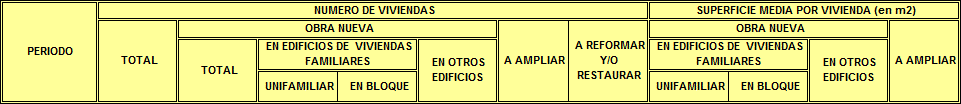

# MIVAU-BOL09-VISADOS: visados de dirección de obra (obra nueva, ampliación, reforma)

Tabla `mivau_visados_direccion_obra`. Serie mensual NACIONAL (el archivo no trae comunidades ni provincias).

## URL
https://apps.fomento.gob.es/BoletinOnline/sedal/09010600.XLS (columna `fuente` de `etl/catalogo/tablas.csv`). Ruta antigua `BoletinOnline`, no `BoletinOnline2`.

## Archivo y fecha de descarga
`etl/descargas/MIVAU-BOL09-VISADOS_AAAAMMDD.xls` (no versionado). Descargado el 2026-10-29 (pie: "Fecha: 28/10/2026"). Copia completa en `tests/fixtures/09010600.xls` (1,1 MB, versionada; el tamaño se debe a un logotipo JPEG incrustado de 1 MB). Destino: `etl/salida/mivau_visados_direccion_obra.csv`.

## Estructura del original
Un libro .xls con una sola hoja, `APAREJA_6` (430 filas x 14 columnas). Título en A2: "6.- VISADOS DE DIRECCIÓN DE OBRA. OBRA NUEVA, AMPLIACIÓN Y/O REFORMA DE EDIFICIOS"; A4: "N.º de viviendas y superficie media según tipo de obra y destino principal"; A6: "TOTAL NACIONAL" (único territorio).

- **No hay cabeceras de columna en texto**: los rótulos son una imagen GIF incrustada (961 x 104 px), que se extrajo del flujo del libro y se leyó: PERIODO | NUMERO DE VIVIENDAS: TOTAL; OBRA NUEVA: TOTAL, EN EDIFICIOS DE VIVIENDAS FAMILIARES (UNIFAMILIAR, EN BLOQUE), EN OTROS EDIFICIOS; A AMPLIAR; A REFORMAR Y/O RESTAURAR | SUPERFICIE MEDIA POR VIVIENDA (en m2): OBRA NUEVA: EN EDIFICIOS DE VIVIENDAS FAMILIARES (UNIFAMILIAR, EN BLOQUE), EN OTROS EDIFICIOS; A AMPLIAR.

Receta de extracción (reproducible): `python -m etl.herramientas.extraer_imagenes_xls tests/fixtures/09010600.xls <carpeta>` recorre el flujo Workbook del .xls, une los registros MsoDrawingGroup y guarda cada imagen (la de ~1 MB es el logotipo; la pequeña es la cabecera). Copia guardada en `docs/fuentes/img/MIVAU-BOL09-VISADOS_cabecera.gif`.

| Columna de la hoja | Texto de la imagen | Columna destino |
|---|---|---|
| D | NUMERO DE VIVIENDAS: TOTAL | `tipo_obra = TOTAL`, `num_viviendas` |
| E | OBRA NUEVA: TOTAL | `OBRA_NUEVA` |
| F | EN EDIFICIOS DE VIVIENDAS FAMILIARES: UNIFAMILIAR | `OBRA_NUEVA_UNIFAMILIAR` |
| G | EN EDIFICIOS DE VIVIENDAS FAMILIARES: EN BLOQUE | `OBRA_NUEVA_EN_BLOQUE` |
| H | EN OTROS EDIFICIOS | `OBRA_NUEVA_OTROS_EDIFICIOS` |
| I | A AMPLIAR | `AMPLIACION` |
| J | A REFORMAR Y/O RESTAURAR | `REFORMA_RESTAURACION` |
| K | SUPERFICIE MEDIA POR VIVIENDA (m2): OBRA NUEVA, UNIFAMILIAR | `superficie_media_m2` en `OBRA_NUEVA_UNIFAMILIAR` |
| L | ... EN BLOQUE | `superficie_media_m2` en `OBRA_NUEVA_EN_BLOQUE` |
| M | ... EN OTROS EDIFICIOS | `superficie_media_m2` en `OBRA_NUEVA_OTROS_EDIFICIOS` |
| N | ... A AMPLIAR | `superficie_media_m2` en `AMPLIACION` |

La imagen salió algo borrosa (GIF de 961 x 104); los rótulos de las dos primeras filas se leen con claridad al ampliarla.

- Columna A: año; columna C: mes; valores en D a N (11 columnas).
- Filas 8 a 12: totales anuales 2025 a 2021. Filas 14 a 429: meses descendentes de 2026M06 (fila 14) a 1991M11 (fila 429), el año solo en la primera fila de cada bloque. Fila 430: fuente y fecha.
- Correspondencia (la imagen es la fuente; las sumas se cumplen en los 416 meses y solo comprueban que los subtotales y los grupos de columnas están en su sitio, no el orden dentro de cada suma): D = total; E = obra nueva total; F = unifamiliar; G = en bloque; H = otros edificios; I = ampliación; J = reforma y/o restauración; K = superficie media unifamiliar; L = en bloque; M = otros edificios; N = ampliación. Las superficies también se comprobaron con las viviendas: p. ej. 2026M06 ampliación 161,9127 m2 x 275 viviendas = 44.526 m2 enteros; otros edificios 126,67 m2 x 18 = 2.280 m2.
- El título menciona "destino principal", pero el archivo solo desglosa por tipo de obra (todo es vivienda): no hay dimensión de destino.

## Transformaciones
1. `mivau.leer_serie_vertical` (lector nuevo en `etl/lib/mivau.py`) pasa la hoja a formato largo y descarta las filas anuales.
2. `fuente_comun.serie_vertical_a_tabla` aplica el mapa columna -> (`tipo_obra`, medida) de `etl/fuentes/mivau_visados.py`; falla si hay datos en una columna no mapeada.
3. "TOTAL NACIONAL" -> `ES`. `num_viviendas` entero (Int64); `superficie_media_m2` decimal redondeada a 4 cifras (DECIMAL(10,4)), solo para 4 tipos de obra. `-` -> NULL (46 meses en "otros edificios", cuando hubo 0 viviendas); el 0 literal se conserva.
4. `provisional` = 0, `fecha_descarga` = día de ejecución.

Resultado: 2.912 filas = 7 tipos de obra x 416 meses (1991M11 a 2026M06).

## Decisiones
- Tabla `mivau_visados_direccion_obra` (el brief proponía `mivau_visados_obra_nueva`): el archivo incluye ampliación y reforma, no solo obra nueva, y el nombre debe reflejar el contenido.
- Dimensión `tipo_obra` con `TOTAL`, `OBRA_NUEVA`, `OBRA_NUEVA_UNIFAMILIAR`, `OBRA_NUEVA_EN_BLOQUE`, `OBRA_NUEVA_OTROS_EDIFICIOS`, `AMPLIACION`, `REFORMA_RESTAURACION`. `TOTAL` y `OBRA_NUEVA` son subtotales del original (evitar el doble recuento al sumar).
- Dos medidas como columnas de la misma tabla (`num_viviendas`, `superficie_media_m2`): comparten dimensión. La superficie media es NULL en `TOTAL`, `OBRA_NUEVA` y `REFORMA_RESTAURACION` (la fuente no la publica).
- Filas anuales no cargadas (son la suma de los meses; comprobado 2021-2025).
- Rótulos tomados de la imagen incrustada, no de texto del archivo. Pendiente de revisión por el usuario.
- Sin CCAA ni provincia: el archivo es solo nacional (el catálogo preveía CCAA y provincia).
- Ver `docs/decisiones.md` (2026-10-29).

## Limitaciones
- Solo nivel nacional. Sin marca de provisional. Serie desde 1991M11.
- La superficie media es una media publicada: no se suma.
- Dependencia del mapa de columnas por posición. Controles en cada ejecución: (a) una columna con datos fuera del mapa hace fallar el proceso; (b) `IDENTIDADES`: TOTAL = OBRA_NUEVA + AMPLIACION + REFORMA_RESTAURACION y OBRA_NUEVA = suma de sus tres tipos de edificio, cada mes; (c) `PRODUCTOS`: superficie media x viviendas debe ser un número entero de m2 (tolerancia 0,01 m2) en los cuatro tipos con superficie, lo que detecta intercambiar las columnas de superficie entre sí o con las de viviendas. Si algo falla, el proceso para con la identidad y el primer periodo. NO se detecta un intercambio entre partes de la misma suma (AMPLIACION <-> REFORMA_RESTAURACION, o unifamiliar <-> bloque <-> otros edificios en `num_viviendas`): esos casos solo se verían contra la imagen.

## Valores comprobados
- ES 2026M06: total 17149 (D14), obra nueva 14603 (E14), unifamiliar 2455 (F14), en bloque 12130 (G14), otros edificios 18 (H14), ampliación 275 (I14), reforma 2271 (J14).
- Superficie media 2026M06: unifamiliar 192,0029 (K14), en bloque 97,9338 (L14), ampliación 161,9127 (N14). `-` en M24 (otros edificios, 2025M08, con 0 viviendas en H24).
- Cuadre entre categorías (test `test_cuadre_entre_categorias_visados`): TOTAL = obra nueva + ampliación + reforma y obra nueva = unifamiliar + bloque + otros, en los 416 meses, sin excepciones. El cuadre territorial no aplica (solo nivel nacional).
